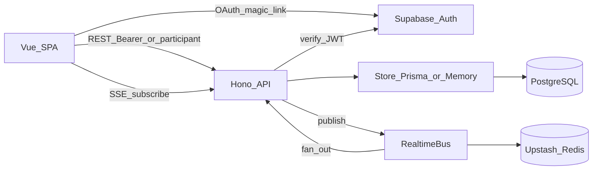
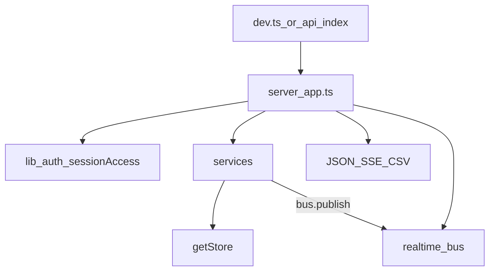
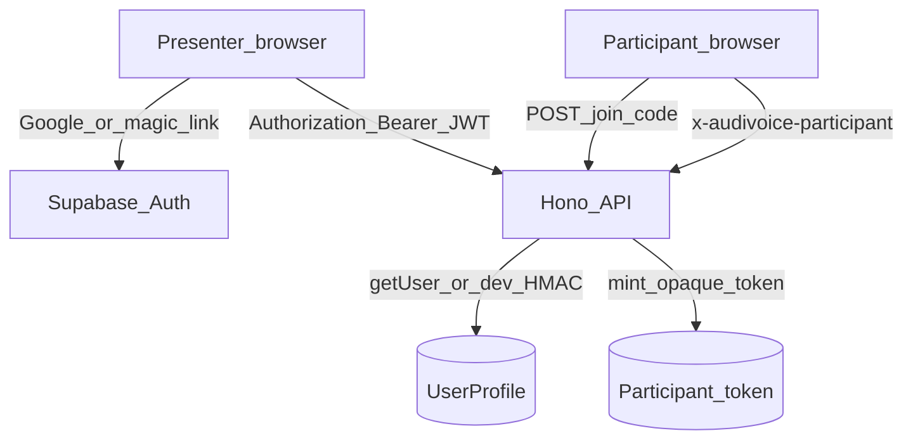
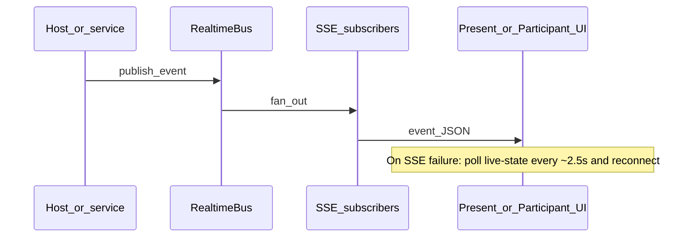
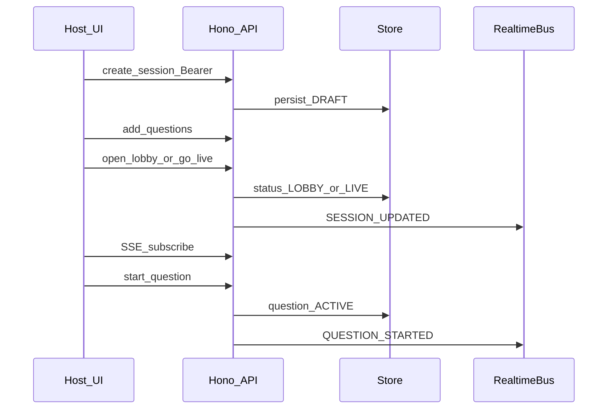
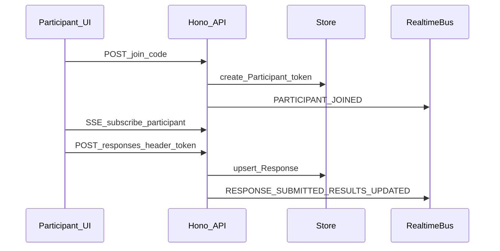

# Audivoice architecture

System shape for interactive audience engagement: hosts create sessions, share a join code or QR, and collect live responses (polls, Q&A-style flows, quizzes, surveys, ratings, content slides). Participants join without an account when guest access is enabled.

For local setup, env vars, and Vercel deploy steps, see [README.md](./README.md).

## System context

Three product surfaces share one Vue SPA and one Hono API:

| Surface | Who | Routes (examples) |
|---|---|---|
| Marketing | Public / SEO | `/`, `/features/`, `/blogs/`, `/contact/` |
| Host app | Authenticated presenters | `/auth`, `/onboarding`, `/app/sessions/*`, `/app/admin` |
| Participant | Anonymous join token | `/join`, `/join/:code`, `/participant/:sessionId` |

Capacity design target: **200 concurrent participants per session**.

## Topology

**Deploy (Vercel):** static Vite build + single serverless function [`api/index.ts`](./api/index.ts). Locally, [`server/dev.ts`](./server/dev.ts) serves the same Hono app on port 3001 while Vite proxies `/api`.

## Repository map

| Path | Role |
|---|---|
| [`api/`](./api/) | Vercel entry — exports the Hono app |
| [`server/`](./server/) | HTTP routes, auth, services, store, realtime bus |
| [`shared/`](./shared/) | DTOs and domain types shared by client and server |
| [`prisma/`](./prisma/) | Schema, migrations, seed |
| [`src/`](./src/) | Vue 3 app (views, components, Pinia, API client) |
| [`scripts/`](./scripts/) | Sitemap generation, marketing HTML prerender |

## Backend layers

| Layer | Location | Responsibility |
|---|---|---|
| Entry | [`server/dev.ts`](./server/dev.ts), [`api/index.ts`](./api/index.ts) | Bootstrap / serverless export |
| HTTP | [`server/app.ts`](./server/app.ts) | Routes, CORS, Zod validation, rate limits, SSE |
| Auth helpers | [`server/lib/auth.ts`](./server/lib/auth.ts), [`sessionAccess.ts`](./server/lib/sessionAccess.ts) | Presenter JWT, participant token, ownership, dual viewer |
| Domain | [`server/services/`](./server/services/) | Session, question, participant, profile, admin, results |
| Persistence | [`server/store/`](./server/store/) | `Store` interface; MemoryStore or PrismaStore |
| Realtime | [`server/realtime/bus.ts`](./server/realtime/bus.ts) | In-process or Upstash-backed pub/sub |

Services talk only to `getStore()` — never to Prisma directly. Store selection ([`server/store/index.ts`](./server/store/index.ts)):

- **MemoryStore** (`.data/audivoice.json`) when `USE_MEMORY_DB=true` or `DATABASE_URL` is missing/placeholder — **local only**; forbidden when `VERCEL=1` or `NODE_ENV=production`.
- **PrismaStore** when a real `DATABASE_URL` is set — required in production.

### API surface (grouped)

All routes live in [`server/app.ts`](./server/app.ts):

- **Public:** health, contact, join, localhost-only `POST /api/auth/dev-login`
- **Presenter (Bearer):** `/api/me*`, sessions, questions, results, export, QR, login audit
- **Shared live (presenter or participant):** session public DTO, live-state, SSE subscribe
- **Participant:** `POST /api/responses` via `x-audivoice-participant`
- **Admin:** contacts, login audits, users (Google + admin email)

## Auth model

### Presenter

1. Browser obtains a Supabase session (Google or email magic link).
2. API calls send `Authorization: Bearer <access_token>`.
3. Server verifies via Supabase (`auth.getUser`) or, on localhost only, HMAC **dev tokens** ([`server/lib/devAuth.ts`](./server/lib/devAuth.ts)).
4. App profile is upserted by `authUserId` into `UserProfile` (no passwords in app DB).
5. Session ownership: `session.createdById === profile.id`.

**Admin:** Google provider and email matching [`ADMIN_EMAIL`](./shared/admin.ts) (`support@audivoice.com`). Dev tokens are never admin.

### Participant

1. `POST /api/join` with join code mints an opaque token stored on `Participant`.
2. Later requests use header `x-audivoice-participant` (legacy `x-pulse-participant` still accepted).
3. SSE uses query `?participant=` because `EventSource` cannot send custom headers.
4. Dual-viewer routes ([`sessionAccess.ts`](./server/lib/sessionAccess.ts)): owning presenter first, else active participant for that session.

Participants cannot access `DRAFT` sessions; join is blocked for `DRAFT` / `ENDED`.

## Realtime

1. Mutations persist through the store; services compute aggregated results where needed.
2. Events publish on `RealtimeBus` ([`server/realtime/bus.ts`](./server/realtime/bus.ts)).
3. Clients subscribe via `GET /api/realtime/subscribe?sessionId=…` (SSE), authenticated with presenter JWT or participant token in the query string.
4. On SSE failure, [`useRealtime`](./src/composables/useRealtime.ts) polls `/api/sessions/:id/live-state` every ~2.5s and auto-reconnects.

**Bus implementations:**

| Mode | When | Behavior |
|---|---|---|
| MemoryBus | No Redis env (typical local) | In-process fan-out only |
| UpstashBus | `REDIS_URL`+`REDIS_TOKEN` or Upstash REST vars | List + pub for multi-instance delivery |

Event types are defined in [`shared/types.ts`](./shared/types.ts) (`SESSION_UPDATED`, `QUESTION_STARTED`, `RESULTS_UPDATED`, …). Participant SSE payloads are sanitized ([`participantSafe.ts`](./server/lib/participantSafe.ts)).

Without Redis on Vercel, the in-process bus does not cross serverless instances — Redis is required for reliable multi-instance live sessions.

## Domain and data

Core entities ([`prisma/schema.prisma`](./prisma/schema.prisma), mirrored in [`server/store/types.ts`](./server/store/types.ts)):

| Entity | Notes |
|---|---|
| UserProfile | Presenter profile + onboarding fields; linked by `authUserId` |
| Session | Join code, status, settings, `activeQuestionId` |
| Question / QuestionOption | Types include interactive + content slides |
| Participant | Opaque `token`, optional display name |
| Response / ResponseAnswer | Unique per `(questionId, participantId)` |
| ContactSubmission | Marketing contact form |
| LoginAudit | Presenter sign-in audit trail |

### Session lifecycle

`DRAFT` → `LOBBY` → `LIVE` (optional `PAUSED`) → `ENDED`

### Question lifecycle

`DRAFT` → `ACTIVE` → `CLOSED` (reopen/clear supported for hosts)

Question types and realtime event names live in [`shared/types.ts`](./shared/types.ts).

## Frontend surfaces

Bootstrap: [`src/main.ts`](./src/main.ts) → Pinia + Vue Router + `@unhead/vue`. Routes and guards: [`src/router/index.ts`](./src/router/index.ts).

| Area | Layout / entry | Notes |
|---|---|---|
| Marketing | [`MarketingLayout.vue`](./src/layouts/MarketingLayout.vue) | Trailing-slash URLs; content in [`src/content/marketing/`](./src/content/marketing/); SEO via [`usePageSeo`](./src/composables/usePageSeo.ts) |
| Auth / onboarding | `/auth`, `/auth/callback`, `/onboarding` | Supabase browser client; profile from `/api/me` |
| Host | `/app/*` | Auth + onboarding gates; editor, present, settings, admin |
| Participant | `/join`, `/participant/:sessionId` | Token in localStorage; live UI driven by SSE |

### Pinia stores

| Store | File | Role |
|---|---|---|
| auth | [`authStore.ts`](./src/stores/authStore.ts) | Supabase session, profile, onboarding, admin, dev-login |
| session | [`sessionStore.ts`](./src/stores/sessionStore.ts) | Host sessions, questions helpers, results |
| participant | [`participantStore.ts`](./src/stores/participantStore.ts) | Join token + display name |
| question | [`questionStore.ts`](./src/stores/questionStore.ts) | Active question |
| realtime | [`realtimeStore.ts`](./src/stores/realtimeStore.ts) | Connection state for UI |

REST: single client [`src/services/api.ts`](./src/services/api.ts) (Bearer + participant headers). Live present/participant views also call the API directly for mutations.

### Marketing build

`npm run build` runs sitemap generation → `vue-tsc` → Vite build → [`scripts/prerender-marketing.mjs`](./scripts/prerender-marketing.mjs) (copies built `index.html` into marketing path folders with injected meta — not full Vue SSR).

## Key flows

### Host creates and presents

### Participant joins and answers

### Marketing contact → admin

1. Public form posts to `POST /api/contact` (rate-limited).
2. Stored as `ContactSubmission`.
3. Admin UI (`/app/admin`) lists contacts, login audits, and users via `/api/admin/*` (admin-gated).

## Deployment notes

- **Vercel:** [`vercel.json`](./vercel.json) rewrites `/api/*` → `/api` (Hono path routing) and SPA fallback to `index.html`; API `maxDuration` 60s; `Cache-Control: no-store` on API.
- **Postgres** required on Preview/Production; run `prisma migrate deploy` (not `db push` / `migrate dev`).
- **Upstash Redis** required on Vercel for cross-instance realtime.
- **Supabase** for presenter auth; set browser (`VITE_*`) and server env vars; never expose the service role as a `VITE_` variable.

Full env tables and deploy checklist: [README.md](./README.md). Auth E2E checklist: [AUTH_PRODUCTION_TEST.md](./AUTH_PRODUCTION_TEST.md).
